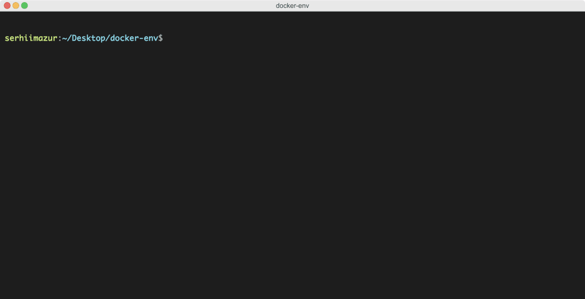

# Next.js

Two install modes. Disk path: `nextjs/{DOMAIN_FULL}/`.

## Create

CLI: **2 New site → Next.js**, then:

| Key | Mode |
| --- | --- |
| 1 Docker | App from the Next.js template, routed through Nginx |
| 2 Local | `create-next-app` on the host, then the same Nginx route |

Web UI create uses the Docker path.

Nginx is required for both modes. Docker mode runs the template image.

Local mode:

- Keeps the create-next-app folder and writes `docker/docker-compose.yml` and `docker/.env` into it, the same place a Docker site uses.
- The container joins `dockerwp` and sets `VIRTUAL_HOST`, so Nginx picks up the host. Create and Start also add it to the hosts file.
- The dev server mounts your project but keeps its own `node_modules`, so the install on your machine is not touched.

You choose Next.js and Node versions (Enter accepts the listed defaults). Confirm with `y`.

Docker create runs `npm i` in the project folder after containers are up.

## URLs

| What | Example |
| --- | --- |
| Site | `https://dev.app.local` |

Container: `{shortname}-nextjs`.

[Getting started](../getting-started.md)
