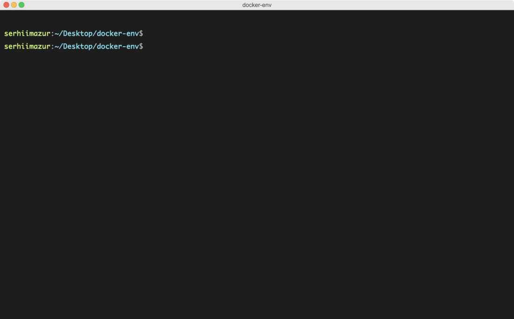

# WordPress

Classic WordPress in Docker behind [Nginx](../system.md). Disk path: `wordpress/{DOMAIN_FULL}/`.

## Create

CLI: **2 New site → Wordpress**. Web UI: **Create**, type WordPress (the button shows only in [development mode](../getting-started.md#development-mode)).

Nginx must already be running.

Setup types:

| Key | Meaning |
| --- | --- |
| 1 default | Domain + host, rest of the values are filled for you |
| 2 custom | You set DB name, table prefix, WP version, user, password, empty content, multisite, PHP |
| 3 beetroot | Agency preset; default host is `{name}.local` instead of `dev.{name}.local` |

Prompts:

1. Short name, e.g. `blog` → default host `dev.blog.local`
2. Confirm the summary (`y`)
3. Optional clone of a Git repo or theme after install

Custom defaults if you press Enter: database `db`, prefix `wp_`, user `developer`, password `1`, latest WP, PHP from the list, not empty, single site.

After create, macOS/Linux hosts are updated. [Windows hosts](../system.md#hosts-file).

## URLs

Replace the host with yours:

| What | URL |
| --- | --- |
| Site | `https://dev.blog.local` |
| wp-admin | `https://dev.blog.local/wp-admin` |
| phpMyAdmin | `https://dev.blog.local.phpmyadmin` |
| Mail | `https://dev.blog.local.mail` |

Default admin: user `developer`, password `1` (unless you changed them on custom).

## Layout

- `wp-docker/` — Compose
- `wp-content/` — themes, plugins, uploads
- `wp-database/` — SQL dumps

App container: `{shortname}-wordpress`.

## After install

**3 Sites → pick the site**, then:

- **Open site**, **Start** / **Stop**, **Shell**
- **Database** — import, export, search-replace, replace project from DB
- **WordPress** — Composer install (theme), Composer package, delete site data, convert to multisite
- **More** — restart, rebuild, Git, archive, remove

[Getting started](../getting-started.md) · [Bedrock](bedrock.md)
