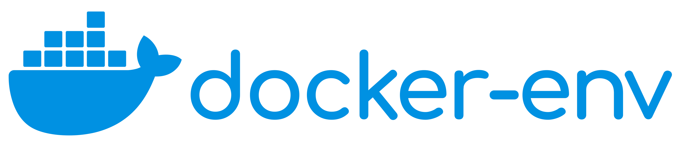
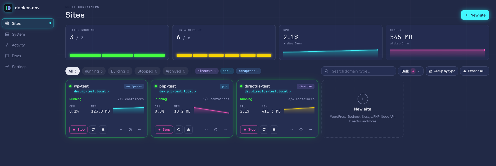

<p align="center">
  
</p>

<p align="center">
  <a href="https://github.com/SerhiiMazurBeetroot/devENV/releases">
    
  </a>
</p>

# docker-env

Run local WordPress, PHP, Next.js and other sites in Docker, each on its own HTTPS domain such as `https://dev.blog.local`.

You answer a few questions in a terminal menu (or click **New site** in the browser dashboard) and docker-env sets up the containers, the database, the SSL certificate and the hosts entry for you.

<p align="center">
  
  
  
  
</p>

### Works on

<p align="center">
  
  
  
</p>

### Creates

<p align="center">
  
  
  
  
  
  
</p>

## What you get

- **One proxy for every site.** A shared Nginx reverse proxy routes each domain to its project, so sites never fight over ports.
- **Trusted HTTPS.** mkcert issues local certificates. Trust the local CA once and the browser shows no warnings.
- **Ready-made stacks.** Database, admin tool and mail catcher come set up with each project.
- **Two ways to work.** A terminal menu (`docker-env`) and a browser dashboard at [http://127.0.0.1:7777](http://127.0.0.1:7777). Both run the same scripts.
- **Logs in the browser.** Dozzle at [http://127.0.0.1:7007](http://127.0.0.1:7007) shows live logs for every container.

## Requirements

Install these on your computer (not inside a container):

| Tool | Version | Notes |
| --- | --- | --- |
| [](https://docs.docker.com/engine/install/) | 20.10+ with Compose v2 | Docker Desktop includes Compose v2. On Linux, install the Compose plugin if `docker compose version` fails. |
| [](https://jqlang.github.io/jq/download/) | any | Reads the project list and settings. |
| [](https://nodejs.org/) | any current LTS | Runs the CLI health check. |

## Quick start

**1. Install.** From the repository folder, run:

```bash
./setup.sh
```

This adds a `docker-env` command to your shell. Restart the terminal, then you can run it from any folder:

```bash
docker-env
```


**2. Start the proxy.** In the menu choose **System → Nginx proxy → Start**. This starts Nginx, mkcert, Dozzle and the Web UI. Every site runs behind this proxy, so it must be running before you create or open a site.

**3. Trust the certificate.** Follow [Trust the local CA](./.env-core/docs/system.md#trust-the-local-ca) once so browsers accept your local HTTPS sites.

**4. Create a site.** Choose **2 New site**, pick a type, and enter a short name such as `blog`. When it finishes, open `https://dev.blog.local`.

On macOS and Linux the hosts file is updated for you (you may be asked for your password). On Windows, add the lines the CLI prints to your [hosts file](./.env-core/docs/system.md#hosts-file).

You can also skip the menu:

```bash
docker-env create --type wordpress --name blog
```

More detail: [Getting started](./.env-core/docs/getting-started.md).

## Project types

| Type | What's included | Guide |
| --- | --- | --- |
|  |       | [wordpress.md](./.env-core/docs/projects/wordpress.md) |
|  |      | [bedrock.md](./.env-core/docs/projects/bedrock.md) |
|  |  plain app container | [php.md](./.env-core/docs/projects/php.md) |
|  |   in Docker or from a local folder | [nextjs.md](./.env-core/docs/projects/nextjs.md) |
|  |    | [directus.md](./.env-core/docs/projects/directus.md) |
|  |    | [elasticsearch.md](./.env-core/docs/projects/elasticsearch.md) |

Every site gets its own URLs for its tools, for example:

| What | URL |
| --- | --- |
| Site | `https://dev.blog.local` |
| phpMyAdmin | `https://dev.blog.local.phpmyadmin` |
| Mail (Mailhog) | `https://dev.blog.local.mail` |

## Shared services

These run once and serve every project.

| Service | Address | What it does |
| --- | --- | --- |
| [](https://hub.docker.com/r/nginxproxy/nginx-proxy) | ports 443 and 8080 | Routes each domain to the right project |
| [](https://github.com/aegypius/mkcert-for-nginx-proxy) | — | Creates and renews local SSL certificates |
| [](https://dozzle.dev/) | [127.0.0.1:7007](http://127.0.0.1:7007) | Live container logs in the browser |
|  | [127.0.0.1:7777](http://127.0.0.1:7777) | Dashboard to create, start, stop, rebuild and delete sites |

The Web UI asks for a sign-in token. Get it from **System → Web UI → Sign-in token**. See [Web UI](./.env-core/docs/web-ui.md).

<p align="center">
  <a href="./.env-core/docs/images/webui.png"></a>
</p>


## Walkthroughs

<details>
  <summary><b>The main menu</b></summary>
  
</details>

<details>
  <summary><b>Start the Nginx proxy</b></summary>
  
</details>

<details>
  <summary><b>Create a WordPress site</b></summary>
  
</details>

<details>
  <summary><b>Create a Bedrock site</b></summary>
  
</details>

<details>
  <summary><b>Create a PHP site</b></summary>
  
</details>

<details>
  <summary><b>Create a Next.js site</b></summary>
  
</details>

## Documentation

| Page | Open it when you want to |
| --- | --- |
| [Getting started](./.env-core/docs/getting-started.md) | Install, start Nginx, create your first site, everyday commands |
| [Web UI](./.env-core/docs/web-ui.md) | Use the browser dashboard |
| [System services](./.env-core/docs/system.md) | Understand the proxy, certificates, hosts file, logs and mail |
| [Troubleshooting](./.env-core/docs/troubleshooting.md) | Fix busy ports, certificate warnings, hosts or login problems |

## Credits

Built on [nginx-proxy](https://github.com/nginx-proxy/nginx-proxy), [mkcert-for-nginx-proxy](https://github.com/aegypius/mkcert-for-nginx-proxy) and [Dozzle](https://dozzle.dev/). See also [Docker best practices](https://docs.docker.com/build/building/best-practices/).
